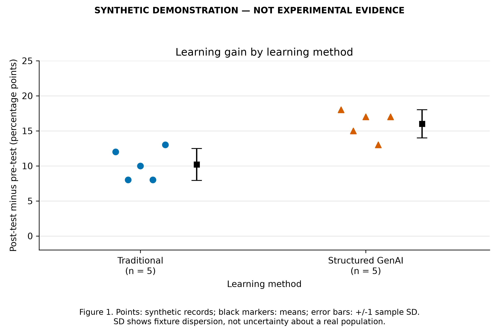
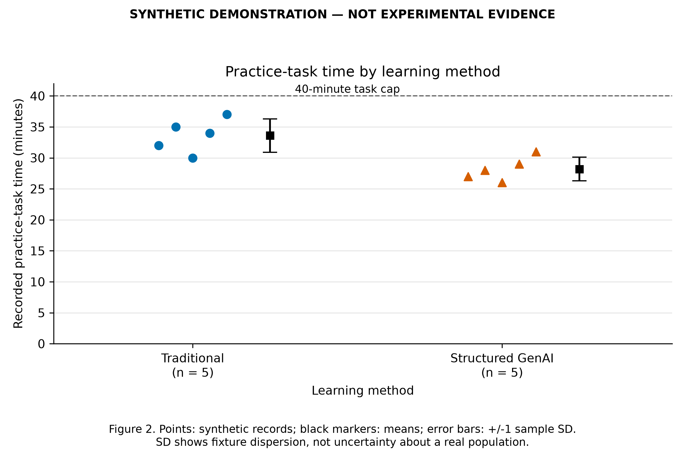

# Structured GenAI and University Learning — Task 3

David Yakubov · Research Methods · Synthetic demonstration

**No real experiment was conducted. All 10 records are invented Task 2 software-test fixtures, not observations from students.** This modest extension demonstrates an executable analysis, two figures and a simple AI-domain mathematical model. It does not establish an effect of GenAI.

## Reproduce

Use Python 3.12.14 (tested). From the extracted project folder:

```console
python -m venv .venv
```

Activate with `.venv\Scripts\activate` on Windows Command Prompt, `.venv\Scripts\Activate.ps1` on PowerShell, or `source .venv/bin/activate` on Linux/macOS. Then:

```console
python -m pip install -r requirements-task3.txt
python src/process_data.py
python src/visualize.py
python -m jupyterlab notebooks/01_data_analysis.ipynb
```

Select the environment's Python kernel and use **Restart Kernel and Run All Cells**. The delivered notebook already contains sequential execution counts, tables and both images. No API keys or paid AI services are needed. Internet access is needed only to install dependencies. Scripts resolve data relative to the project; open the notebook from the root or `notebooks/` folder.

The original Task 2 command still works without third-party dependencies:

```console
python src/benchmark.py --config configs/config.json
python -m unittest discover -s tests -v
```

The original Dockerfile remains a Task 2 runner; it does not install Task 3 notebook dependencies.

## Data and method

`data/raw/test_run.jsonl` is a lossless repackaging of `data/sample/participants.csv` with explicit synthetic provenance and an evaluation phase. Five records belong to each group. No new outcomes, participants, allocation or random measurements were generated. There is no randomness, so no seed is required; the prospective Task 2 allocation seed 20261017 is unchanged and was not used here.

The original validator checks missing fields, finite numeric values, score limits, positive task time up to 40 minutes and duplicate IDs. Both groups must be present; Task 3 additionally requires at least two records per group for SD. Invalid data stops processing rather than being silently dropped or imputed.

**Warm-up adaptation:** task time measures student practice, not LLM latency. All 10 rows are evaluation fixtures; zero rows are excluded. Removing initial or slow students as cold-start runs would change the study incorrectly. This compact implementation rejects non-evaluation phases rather than claiming a hardware warm-up procedure occurred.

We calculate means, medians, sample SD (denominator n−1), minimum and maximum, plus treatment-minus-control differences. SD describes fixture spread; it is not a confidence interval. Bootstrap intervals, tail percentiles, significance tests and advanced models are intentionally outside this small demonstration.

## Results & Discussion

Both groups contain **n = 5 synthetic records**. Values are mean ± sample SD.

| Metric | Traditional, mean ± SD | GenAI, mean ± SD | GenAI − traditional |
|---|---:|---:|---:|
| Learning gain (percentage points) | 10.20 ± 2.28 | 16.00 ± 2.00 | +5.80 |
| Recorded task time (minutes) | 33.60 ± 2.70 | 28.20 ± 1.92 | -5.40 |
| Critical thinking (0–20 points) | 12.00 ± 1.58 | 13.00 ± 1.58 | +1.00 |
| Pre-test (0–100 points) | 56.00 ± 9.62 | 56.00 ± 9.62 | +0.00 |
| Post-test (0–100 points) | 66.20 ± 7.56 | 72.00 ± 7.84 | +5.80 |

The fixed fixture produces a gain difference of +5.8 percentage points, a recorded-time difference of −5.4 minutes and a critical-thinking difference of +1.0 point. These patterns were already encoded in the invented Task 2 sample. They are neither observed treatment effects nor evidence confirming any hypothesis.

The critical-thinking descriptive guardrail passes (+1.0 ≥ −1.0); it does not establish non-inferiority. Numeric validation passes. No rows reach the 40-minute limit (0/5 in each group); time remains a restricted-window metric. Assessment adherence is **not assessed**, not reported as zero violations. Equal pre-test means in this constructed fixture do not prove successful randomization.



Figure 1. Learning gain in percentage points; colored shapes show invented records, black squares show group means, and bars show ±1 sample SD. No confidence interval is implied.



Figure 2. Recorded practice-task time in minutes, with the 40-minute cap marked. Shapes distinguish groups in grayscale; bars show ±1 sample SD. Both figures are provided as 300-DPI PNG and vector PDF.

## Domain model and continuity

See [formal domain model](docs/domain_model.md) for a simple squared-loss group-mean model, notation, target metrics and guardrail. This is a model of outcomes, not training an LLM. [Task 2 methodology](docs/methodology.md) remains unchanged, including the planned 40-person pilot, fair traditional-learning baseline, no-AI assessments and two-sided alternatives. The current 10-row fixture is not the planned pilot.

## Deliverables

```text
data/raw/test_run.jsonl              Small explicitly synthetic fixture
data/processed/participants_clean.csv
data/processed/metrics_summary.csv   Mean, median, SD and range
data/processed/summary.json          Differences, guardrails and provenance
notebooks/01_data_analysis.ipynb      Executed notebook with saved outputs
src/process_data.py                  Validation and aggregation
src/visualize.py                     Two figures, PNG and PDF
docs/domain_model.md                 Formal AI-domain artifact
reports/Task3_Report.md              Concise LMS report
reports/figures/                     Two figures in both formats
requirements-task3.txt               Tested direct dependencies
docs/task3_validation.md             Verification record
```

## Scope, limitations and submission

This submission is a synthetic demonstration, not completion of real Week 7–8 data collection. It uses only descriptive statistics and a minimal domain model. SD/error bars and PDF exports are retained to avoid preventable presentation defects. Acceptance of synthetic data and the warm-up adaptation is the instructor's decision.

The real study still requires approval/consent, finalized assessment materials and AI model/version, recruitment, privately stored raw data, reporting missingness and deviations, and the prespecified inferential analysis. No claim about learning effectiveness, causality or generalizability can be made here.

This Task 3 extension is based on Task 2 commit `c8bb899e4b4fc9bad8bd276e90d9c1b3f6741afd`. The original Task 2 files are retained; its README is archived at `docs/task2_readme.md`. The Task 3 update is published with the owner's authorization. A final GitHub release remains a separate submission step. The Markdown report may be used for LMS, as permitted by the assignment.

Sources: [Task 3 assignment](https://docs.google.com/document/d/11fv0lmbhWcOV-hRr81s4uTP2pwFGiC2w/edit); [Task 2 repository](https://github.com/davidyakubov-glitch/genai-learning-study); author's `Task2_Methodology_Yakubov.pdf` (local original, checked against the repository methodology). Code and synthetic fixture retain the repository's MIT license. Real participant data must never be published in this package.
