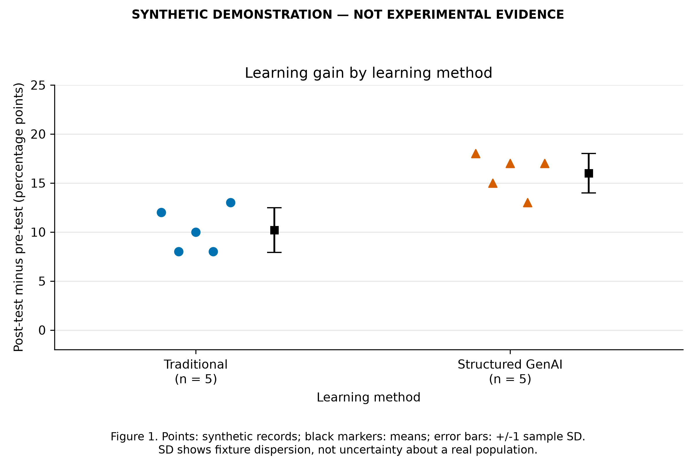
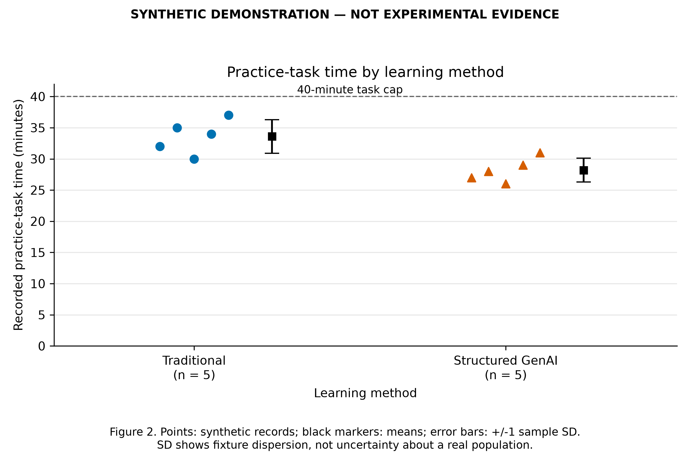

# Task 3: Research Results, Data Analysis and Scientific Visualization

**David Yakubov — Research Methods**

## Status and purpose

This report demonstrates a reproducible analysis for the planned study, *The Impact of Generative AI on University Students' Learning Performance and Critical Thinking*. All numbers come from the 10 invented Task 2 test records (five per group). No students were recruited, no AI model was run and no real experiment was conducted for this submission.

## Method and Task 2 continuity

The comparison remains structured GenAI-assisted learning versus traditional independent learning. The primary metric is post-test minus pre-test, in percentage points. Secondary metrics are recorded task time and critical-thinking score; raw post-test and baseline scores are also reported. The original 40-person pilot plan, equivalent tasks and learning opportunities, blinded scoring, and no-AI assessments remain prospective requirements.

The existing CSV was converted without changing values to a small JSONL fixture. The processing script reuses the Task 2 validator. All ten rows passed and none was excluded. Hardware warm-up filtering is not applicable because these are educational outcomes, not model execution logs. In particular, slower students must not be discarded as cold-start noise. The deterministic analysis requires no random seed and performs no resampling.

The notebook reports means, medians, sample standard deviations and ranges. Treatment-minus-control differences preserve the Task 2 direction convention. Error bars show one sample SD, not confidence intervals. Two figures are exported as 300-DPI PNG and vector PDF.

## Demonstration results

| Metric | Traditional, mean ± SD | GenAI, mean ± SD | GenAI − traditional |
|---|---:|---:|---:|
| Learning gain (percentage points) | 10.20 ± 2.28 | 16.00 ± 2.00 | +5.80 |
| Recorded task time (minutes) | 33.60 ± 2.70 | 28.20 ± 1.92 | -5.40 |
| Critical thinking (0–20 points) | 12.00 ± 1.58 | 13.00 ± 1.58 | +1.00 |
| Pre-test (0–100 points) | 56.00 ± 9.62 | 56.00 ± 9.62 | +0.00 |
| Post-test (0–100 points) | 66.20 ± 7.56 | 72.00 ± 7.84 | +5.80 |

The invented data show +5.8 percentage points of gain difference, −5.4 minutes of recorded-time difference and +1.0 point of critical-thinking difference. These are properties of the pre-existing fixture, not empirical support for the anticipated benefits. Both groups have a pre-test mean of 56; this constructed balance cannot validate the planned allocation procedure.

The critical-thinking sample check satisfies the Task 2 threshold D(C) ≥ −1. Numeric checks pass, and neither group has time-capped rows (0/5 each). No-AI assessment adherence is unobserved and cannot be inferred from scores. Passing a mean check is not statistical proof of non-inferiority.

Figure 1. Learning gain in percentage points. Individual synthetic records, mean and ±1 sample SD are shown; these bars describe fixture dispersion.

Figure 2. Recorded practice-task minutes, with the 40-minute cap. Individual synthetic records, mean and ±1 sample SD are shown.

## Domain model

The [domain model](../docs/domain_model.md) defines a two-group mean predictor for gain with mean squared error loss. Its minimizers are the group means already calculated by the pipeline. It formalizes the outcome comparison without pretending to train a language model. The three future alternative hypotheses remain two-sided; none is tested using these invented records.

## Discussion and limitations

This compact work validates a processing and visualization workflow. It does not estimate real student behavior. The sample is tiny and deliberately constructed; it cannot support causal claims, population estimates, statistical significance or generalization. No bootstrap confidence intervals, advanced adjustment, sensitivity analysis or AI training is included. The sample SD should not be presented as uncertainty about a population effect.

A real continuation must collect consented observations under the frozen Task 2 protocol, document missing outcomes and protocol deviations, and implement the planned two-sided primary comparison and exploratory secondary analysis with appropriate multiplicity handling. The critical-thinking rubric remains project-specific rather than a validated psychometric instrument.

## Reproducibility and submission status

See [README](../README.md) for commands, dependencies and the saved-output notebook. The source, sample fixture and methodology derive from upstream commit `c8bb899e4b4fc9bad8bd276e90d9c1b3f6741afd`. The exact raw input hash is recorded in `data/processed/summary.json`. This synthetic demonstration is published as a Task 3 repository update; a final GitHub release remains a separate submission step. its acceptance as a substitute for real data collection is subject to the course requirements.

## Sources

- [Task 3 assignment](https://docs.google.com/document/d/11fv0lmbhWcOV-hRr81s4uTP2pwFGiC2w/edit).
- Yakubov, D. (2026). *Methodology Passport Card — Task 2*, supplied PDF and [repository methodology](../docs/methodology.md).
- [Task 2 source repository](https://github.com/davidyakubov-glitch/genai-learning-study).
